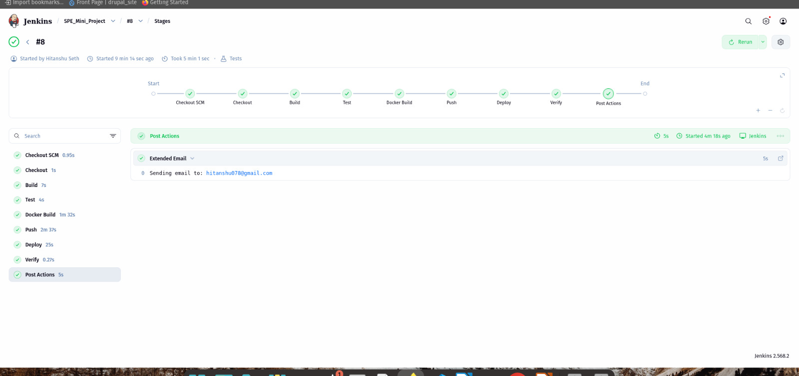
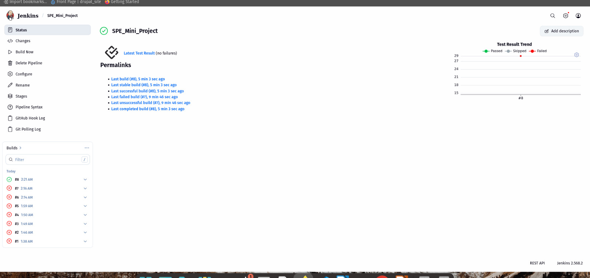
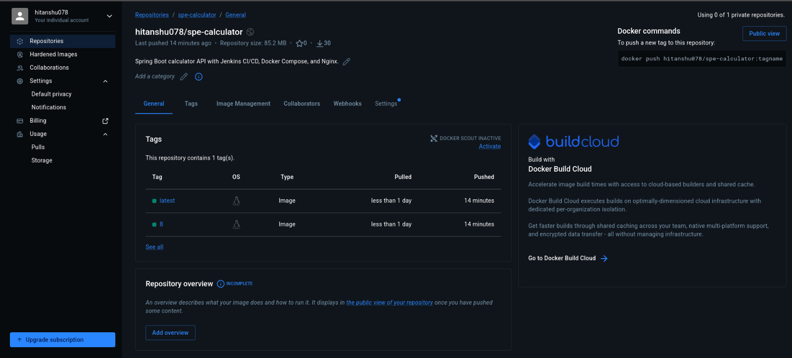
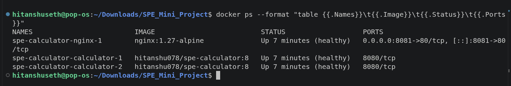
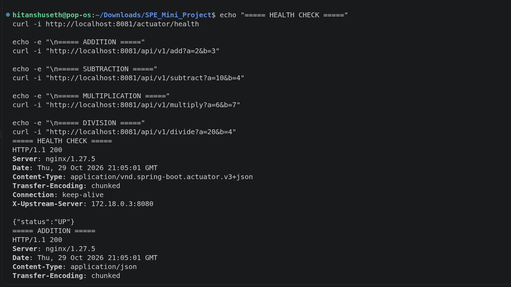
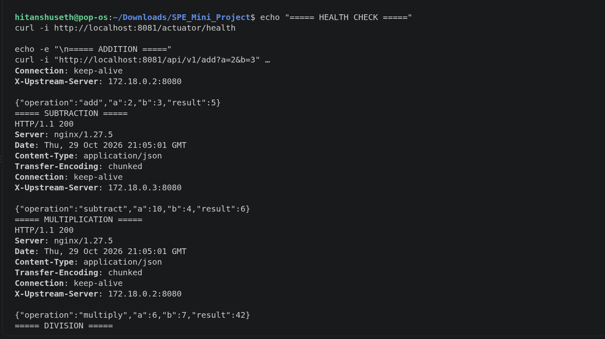
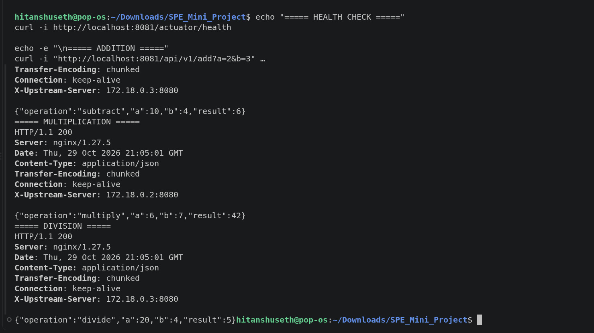
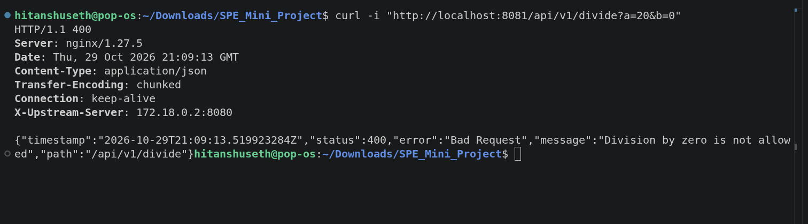
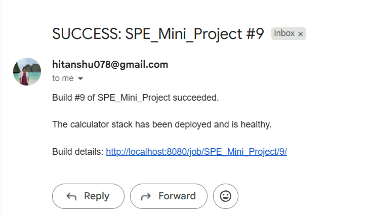

# SPE Mini-Project: Calculator REST API with CI/CD

CSE 816 Software Production Engineering mini-project.

This is a Spring Boot Calculator REST API. A Jenkins pipeline builds, tests, containerizes, pushes and deploys it on every push to GitHub.

```
 git push ──► GitHub ──webhook / Poll SCM──► Jenkins (Ubuntu)
                                               │
   Checkout ► Build ► Test ► Docker Build ► Push ► Deploy ► Verify ► Email
                     (JUnit)              (Docker Hub)  (docker compose)
                                                            │
                                     ┌──────────────────────┴───────────┐
                         host:8081 ► │ nginx ──► calculator (replica 1) │
                                     │       └─► calculator (replica 2) │
                                     └──────────── calc-net ────────────┘
```

## Tech stack

| Layer            | Tool                                       |
|------------------|--------------------------------------------|
| Application      | Java 17, Spring Boot 3.5 (Web + Actuator)  |
| Build            | Maven (via the Maven wrapper, `./mvnw`)    |
| Tests            | JUnit 5, Spring MockMvc                    |
| Version control  | Git / GitHub                               |
| CI/CD            | Jenkins (declarative `Jenkinsfile`)        |
| Containers       | Docker (multi-stage build), Docker Hub     |
| Deployment       | Docker Compose (2 API replicas + Nginx)    |

## API

| Operation | Endpoint                         | Behaviour                         |
|-----------|----------------------------------|-----------------------------------|
| Add       | `GET /api/v1/add?a=&b=`          | `a + b`                           |
| Subtract  | `GET /api/v1/subtract?a=&b=`     | `a - b`                           |
| Multiply  | `GET /api/v1/multiply?a=&b=`     | `a * b`                           |
| Divide    | `GET /api/v1/divide?a=&b=`       | `a / b`; `b = 0` → HTTP 400       |
| Health    | `GET /actuator/health`           | `{"status":"UP"}`                 |

Numbers are handled as `BigDecimal`, so `0.1 + 0.2` returns `0.3`.

Success:

```bash
$ curl "http://localhost:8081/api/v1/add?a=2&b=3"
{"operation":"add","a":2,"b":3,"result":5}
```

Error (division by zero, missing or non-numeric parameter) returns HTTP 400 with:

```bash
$ curl "http://localhost:8081/api/v1/divide?a=5&b=0"
{"timestamp":"2026-10-28T05:00:00Z","status":400,"error":"Bad Request",
 "message":"Division by zero is not allowed","path":"/api/v1/divide"}
```

## Project structure

```
├── src/main/java/com/hitanshu/calculator/
│   ├── CalculatorApplication.java
│   ├── controller/CalculatorController.java    # REST endpoints
│   ├── service/CalculatorService.java          # arithmetic logic
│   ├── dto/                                    # response + error JSON bodies
│   └── exception/GlobalExceptionHandler.java   # maps bad input to HTTP 400
├── src/test/java/...                           # unit + MockMvc integration tests
├── pom.xml, mvnw, .mvn/                        # Maven build + wrapper
├── Dockerfile, .dockerignore                   # multi-stage image
├── docker-compose.yml, nginx/nginx.conf        # deployment stack
├── Jenkinsfile                                 # CI/CD pipeline
├── docs/UBUNTU_SETUP.md                        # step-by-step Jenkins/Docker setup
└── screenshots/                                # proof of a working pipeline
```

## Build, test and run locally

Only a JDK (17+) is required. The Maven wrapper downloads Maven itself.

```bash
./mvnw clean package          # build target/calculator.jar
./mvnw test                   # run tests; reports in target/surefire-reports/
java -jar target/calculator.jar   # run on http://localhost:8080
```

On Windows use `mvnw.cmd` instead of `./mvnw`.

### Run with Docker

```bash
docker build -t spe-calculator .
docker run -d -p 8082:8080 --name calc spe-calculator
curl "http://localhost:8082/api/v1/multiply?a=6&b=7"
```

### Run the full stack with Docker Compose

```bash
docker compose up -d --build     # 2 calculator replicas + nginx on port 8081
docker compose ps                # all containers should be "healthy"
curl -i "http://localhost:8081/api/v1/divide?a=7&b=2"
docker compose down
```

The `X-Upstream-Server` response header shows which replica handled the request. Call the API a few times to see Nginx alternate between them.

## Docker image details

- **Multi-stage:** a `maven:3.9.11-eclipse-temurin-17` stage builds the JAR, and an `eclipse-temurin:17-jre-alpine` stage runs it. The final image contains only a JRE and the JAR.
- **Layer caching:** `pom.xml` is copied and dependencies are resolved before `src/` is copied. Code changes therefore don't re-download dependencies.
- **Security:** the image runs as the unprivileged user `app`, not root.
- Uses `EXPOSE 8080`, a `HEALTHCHECK` on `/actuator/health`, and a `.dockerignore` that keeps the build context small.

## Compose deployment details

- **`calculator`:** 2 replicas, `restart: unless-stopped`, environment variables (`SERVER_PORT`, `JAVA_OPTS`, `TZ`), and a health check on `/actuator/health`.
- **`nginx`:** reverse proxy and load balancer on host port **8081** (Jenkins already uses 8080). It starts only after the API replicas are healthy.
- **`calc-net`:** a dedicated bridge network. The API replicas are not published to the host; all traffic goes through Nginx.

## Jenkins pipeline

| Stage        | What it does                                                               |
|--------------|----------------------------------------------------------------------------|
| Checkout     | Pulls the latest commit from GitHub                                        |
| Build        | `./mvnw clean package -DskipTests`                                         |
| Test         | `./mvnw test`, publishes JUnit XML, fails the build on test failure        |
| Docker Build | Builds the image tagged `:<BUILD_NUMBER>` and `:latest`                    |
| Push         | Logs in to Docker Hub with Jenkins credentials and pushes both tags        |
| Deploy       | `docker compose up -d --wait` with the new tag                             |
| Verify       | Curls `/actuator/health` and a sample API call through Nginx               |
| Post         | Emails build success/failure to the configured address                     |

The pipeline can be re-run safely. `docker compose up -d` only recreates containers whose image changed, and `disableConcurrentBuilds()` stops two builds from deploying at the same time.

### One-time Jenkins setup (Ubuntu)

1. **Give Jenkins access to Docker:**
   ```bash
   sudo usermod -aG docker jenkins
   sudo systemctl restart jenkins
   sudo systemctl enable jenkins docker   # start both on boot
   docker compose version                 # must be Compose v2
   ```
   Jenkins needs JDK 17+ (Jenkins itself requires it) and `curl`.

2. **Plugins** (Manage Jenkins → Plugins): *Pipeline*, *Git*, *GitHub*, *JUnit*, *Email Extension*, *Credentials Binding*. All of these are included in the suggested plugins.

3. **Docker Hub credentials** (Manage Jenkins → Credentials → Global → Add):
   - Kind: *Username with password*
   - Username: your Docker Hub username
   - Password: a Docker Hub **access token** (Account Settings → Personal access tokens)
   - ID: `dockerhub-creds`

4. **Email** (Manage Jenkins → System → *Extended E-mail Notification*):
   - SMTP server: `smtp.gmail.com`, port `465`, *Use SSL*
   - Credentials: your Gmail address + a Gmail **App Password**
   - Configure the same settings under *E-mail Notification* and use *Test configuration* to check them.

5. **Pipeline job:** New Item → *Pipeline* → *Pipeline script from SCM* → Git → `https://github.com/Hitanshu078/SPE_Mini_Project.git`, branch `*/main`, script path `Jenkinsfile`. Run it once manually so Jenkins registers the triggers.

6. **Trigger:**
   - **Poll SCM** (already in the Jenkinsfile) checks GitHub every ~2 minutes. No extra setup is needed.
   - **Webhook (optional):** expose Jenkins with `ngrok http 8080`. In GitHub, go to repo → Settings → Webhooks and add `https://<ngrok-domain>/github-webhook/` (content type `application/json`, *push* events).

No credentials are stored in this repository. Docker Hub and SMTP secrets live only in the Jenkins credentials store.

## Results

The screenshots below come from a real run on Pop!_OS (Ubuntu-based) with Jenkins 2.568.2.

**Jenkins: every stage passed (build #8)**



**Jenkins job page: latest test result, no failures**



**Docker Hub: image pushed with the `latest` and build-number tags**



**Deployed stack: Nginx and 2 calculator replicas, all healthy**



**API through Nginx: health, add, subtract, multiply, divide**

The `X-Upstream-Server` header alternates between `172.18.0.2` and `172.18.0.3`, which shows Nginx sharing requests between the two replicas.





**Error handling: division by zero returns HTTP 400 with a JSON error**



**Email notification sent by Jenkins after a successful build**


